# gdpr-ropa-lint

gdpr-ropa-lint lee un registro CSV de actividades de tratamiento (`activity,purpose,data_subjects,legal_basis,data_categories,special_categories,art9_condition,recipients,third_country,transfer_safeguard,retention,security_measures,lia_ref,profiling,dpia`) y comprueba lo que exige el artículo 30 del RGPD, además de verificaciones de coherencia que haría un DPD a mano: base jurídica del artículo 6, condición del artículo 9 si hay categorías especiales, mecanismo de transferencia si los datos salen del EEE, plazo de conservación, medidas de seguridad, evaluación de interés legítimo y EIPD para la elaboración de perfiles.



**Demo en vivo:** https://jvch0512.github.io/gdpr-ropa-lint/ (datos sintéticos)

## Uso

```bash
make build
build/gdpr-ropa-lint examples
build/gdpr-ropa-lint ropa.csv --tsv
build/gdpr-ropa-lint ropa.csv --fail-on high
```

Códigos de salida: 0 correcto, 1 hallazgos iguales o superiores a `--fail-on`, 2 entrada no válida. La salida es texto por defecto y TSV con `--tsv`; también hay SARIF mediante `scripts/tsv2sarif.py`.

| Regla | Severidad | Qué detecta |
|---|---|---|
| GDP001 | alta | base jurídica vacía o distinta de `consent`, `contract`, `legal_obligation`, `vital_interests`, `public_task`, `legitimate_interests` |
| GDP002 | alta | hay categorías especiales y `art9_condition` está vacía |
| GDP003 | alta | los datos van a un tercer país y `transfer_safeguard` está vacío |
| GDP004 | media | sin plazo de conservación |
| GDP005 | media | sin descripción de medidas de seguridad |
| GDP006 | media | sin destinatarios (escriba `none` si no hay) |
| GDP007 | baja | sin finalidad |
| GDP008 | media | se invoca el interés legítimo y `lia_ref` está vacío |
| GDP009 | media | elaboración de perfiles `yes` y `dpia` distinto de `yes` (el artículo 35.3.a exige EIPD para perfiles sistemáticos y exhaustivos con efectos significativos) |
| GDP010 | baja | el mismo nombre de actividad aparece dos veces |
| GDP011 | media o baja | sin categorías de interesados (artículo 30.1.c): media si el valor está vacío, baja si falta la columna |
| GDP000 | info | fichero vacío o sin columnas `activity` y `legal_basis` |

## Límites

- Comprueba que los campos existen y son coherentes, no que sean ciertos o adecuados.
- Una garantía de transferencia se acepta con cualquier texto no vacío (por ejemplo `SCC 2021`, `adequacy: UK`, `BCR`).
- Los datos del responsable y del DPD van en la cabecera de un RAT completo y no forman parte de este CSV.
- Apoya la revisión de un DPD. No es asesoramiento jurídico.

## Dónde encaja

Revisar el registro de actividades de tratamiento antes de una auditoría o de un requerimiento de la autoridad de control, y mantenerlo limpio en un repositorio.

## Pruebas

```bash
make test
```

## Más información

- Código abierto bajo licencia MIT. Seguridad: [SECURITY.md](SECURITY.md).
- Validación con datos reales: [docs/validation.md](docs/validation.md) (en inglés).
- Versión en inglés: [README.md](README.md).
