# gdpr-ropa-lint

[Español](README.es.md)

gdpr-ropa-lint reads a CSV record of processing activities (`activity,purpose,data_subjects,legal_basis,data_categories,special_categories,art9_condition,recipients,third_country,transfer_safeguard,retention,security_measures,lia_ref,profiling,dpia`) and checks what Article 30 of the GDPR requires to be in it, plus a few consistency checks a DPO would make by hand: a lawful basis from Article 6, an Article 9 condition when special categories are processed, a transfer mechanism when data leaves the EEA, a retention period, security measures, a legitimate-interests assessment and a DPIA for profiling.



**Live demo:** https://jvch0512.github.io/gdpr-ropa-lint/ (Synthetic data.)

Go 1.21+, standard library only. The demo page is rendered from the tool's `--tsv` output by `scripts/site.py` (Python 3, only needed to regenerate the page).

## Use

```bash
make build
build/gdpr-ropa-lint examples
build/gdpr-ropa-lint ropa.csv --tsv
build/gdpr-ropa-lint ropa.csv --fail-on high       # exit 1 on any high finding
```

Exit codes: 0 ok, 1 findings at or above `--fail-on`, 2 bad input. Output is human text by default and TSV with `--tsv` (`# N files, M findings`, then `SEVERITY<TAB>RULE<TAB>WHERE<TAB>MESSAGE`).

| Rule | Severity | What it catches |
|---|---|---|
| GDP001 | high | legal basis is empty or not one of `consent`, `contract`, `legal_obligation`, `vital_interests`, `public_task`, `legitimate_interests` |
| GDP002 | high | special categories are processed and `art9_condition` is empty |
| GDP003 | high | data goes to a third country and `transfer_safeguard` is empty |
| GDP004 | medium | no retention period |
| GDP005 | medium | no description of security measures |
| GDP006 | medium | no recipients listed (write `none` if there are none) |
| GDP007 | low | no purpose |
| GDP008 | medium | legitimate interests relied on and `lia_ref` is empty |
| GDP009 | medium | profiling is `yes` and `dpia` is not `yes` (Article 35(3)(a) requires a DPIA for systematic, extensive profiling with significant effects) |
| GDP010 | low | the same activity name appears twice |
| GDP011 | medium or low | no categories of data subjects (Article 30(1)(c)): medium for an empty value, low when the column is missing |
| GDP000 | info | empty file or no `activity` and `legal_basis` columns |

See [examples](examples) and [docs/sample-output.txt](docs/sample-output.txt).

## Limits

- It checks that fields exist and are consistent, not that they are true or adequate.
- A transfer safeguard is accepted as any non-empty text (for example `SCC 2021`, `adequacy: UK`, `BCR`).
- Controller and DPO details belong in the header of a full RoPA and are not part of this CSV.
- This supports a DPO's review. It is not legal advice.

## Where it fits

Reviewing a RoPA before an audit or a supervisory authority request, and keeping it clean in a repository.

## Tests

```bash
make test    # Go tests: every rule on good and bad rows, CSV quoting, line numbers, hostile input, fuzzing and CLI exit codes through the built binary
```

MIT.

## Code scanning (SARIF)

`scripts/tsv2sarif.py` converts the `--tsv` output into SARIF 2.1.0, so findings show up in GitHub code scanning:

```sh
build/gdpr-ropa-lint examples --tsv | python3 scripts/tsv2sarif.py --tool gdpr-ropa-lint --prefix examples > results.sarif
```

Upload `results.sarif` with `github/codeql-action/upload-sarif`. Severities map to SARIF levels (critical and high to error, medium to warning, low and info to note) and to a `security-severity` score.
